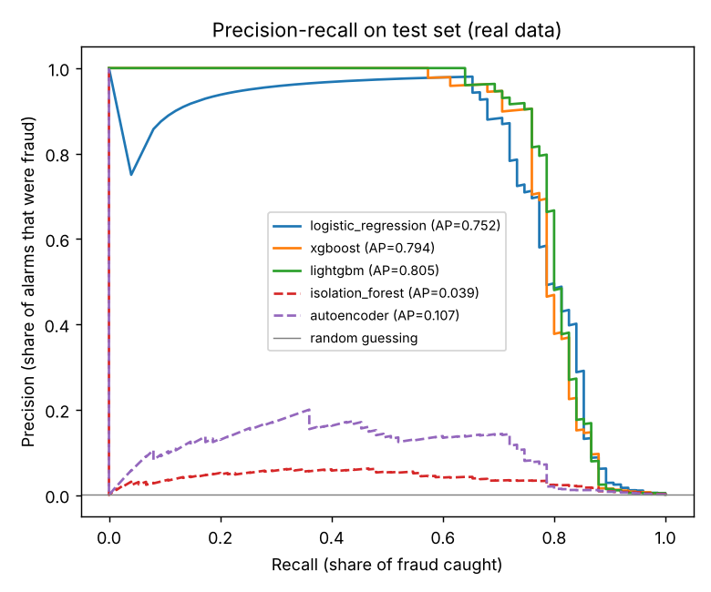

# Credit-Card Fraud Detection on Imbalanced Data

Catching rare fraud in 284,807 card transactions with XGBoost, LightGBM,
anomaly detection, money-based thresholds and SHAP reason codes, plus a
demonstration of how SMOTE leakage fakes great scores.

## Results (real data, newest 20% of transactions as the test set)

Full report: [`reports/results.md`](reports/results.md). Test set: 56,962
transactions, **75 of them fraud**.

| What | Result |
|---|---|
| "Everything is legit" baseline | **99.87% accuracy, 0 fraud caught** |
| LightGBM (best on validation) | PR-AUC **0.805** (95% CI 0.72–0.89), catches 77% of fraud, 82% of alarms are real fraud |
| XGBoost / logistic regression | PR-AUC 0.794 / 0.752, with CIs that overlap LightGBM's: **statistically a tie** |
| SMOTE done wrong vs right (5-fold CV) | **1.000** vs **0.864** PR-AUC: the "perfect" score is leakage |
| Autoencoder / Isolation Forest (no labels) | PR-AUC 0.107 / 0.039: ~80× / ~30× better than random (0.0013), far below supervised |
| Cost-tuned threshold | **Did not beat the default 0.5 on test** ($4,255 vs $3,347). See below |



### What surprised me (and what I'd say in an interview)
1. **The cost-tuned threshold went up, not down.** I expected that "missed fraud
   is expensive" would push the alarm line lower. But in this data **44–60% of
   frauds are smaller than the $10 review cost** (median test fraud: $4.69),
   so checking them costs more than it saves.
2. **The tuned threshold failed on test.** The cost curve is almost flat from
   0.3 to 0.9, and the validation optimum (0.910) sat right at a cliff. A single
   ~$1,000 fraud scored just below 0.91 on test, and missing it is the whole
   gap. With only 57 frauds in validation, the "best" threshold was mostly noise.
   I kept the method as planned rather than re-tuning after seeing the test
   result, because that would be leakage too. A better approach would choose the
   threshold from out-of-fold predictions over more data, or pick the middle of
   the flat region.
3. **Model rankings are within noise.** With 75 test frauds, the bootstrap CIs
   for all three supervised models overlap.
4. **Unsupervised models found something but not much.** They beat random by a
   wide margin, but they're a safety net for new patterns, not a replacement.

Data notes: 284,807 rows, 492 fraud (0.173%), no missing values, file MD5
`e90efcb83d69faf99fcab8b0255024de`. 1,081 rows are exact duplicates. They were
kept. I checked: none of the 773 duplicate groups crosses the
train/val/test boundary, so they don't leak between splits.

---

## The whole project, explained like you're 5

### 🍪 The cookie jar problem
Imagine a jar with **1,000 cookies**. Only **2** are poisoned. Everything else is yummy.

Your job: build a robot that finds the poisoned cookies.

### 🤖 The lazy robot
A lazy robot says *"every cookie is fine!"* It's right about 998 cookies,
so it's **99.8% correct**. Sounds amazing!
But it found **zero** poisoned cookies. Someone still gets sick.

**Lesson:** when the bad thing is rare, "percent correct" (accuracy) lies.
We use a better score, **PR-AUC**, which only gets high if the robot
actually finds the poisoned cookies *without* yelling "poison!" at every
cookie in the jar.

### 🏋️ Making the robot care about the rare ones (class weights)
If the robot gets one point for each cookie it gets right, it ignores the
2 poisoned ones. So we change the rules: **finding a poisoned cookie is
worth ~500 points.** Now the robot pays attention. That's what
`scale_pos_weight` and `class_weight="balanced"` do.

### 🧸 The copycat trick that cheats (SMOTE leakage)
Another idea: make more practice poisoned cookies by mixing two real
poisoned ones together, like play-dough. That's **SMOTE**.

But here's the trap. Suppose you make the play-dough copies *before*
you hide the quiz cookies. Some copies were made from quiz cookies,
so the robot has secretly seen the quiz answers. It gets a perfect
score in practice, then fails in real life.

**Rule:** only make copies from the practice cookies, *after* you've
hidden the quiz. This project shows both ways side by side, and the cheating
way gets a suspiciously perfect score.

### 📅 Quizzes come from the future (time split)
In real life, the robot learns from yesterday's cookies and gets tested on
tomorrow's. So we sort transactions by time: **oldest 60% to learn from, next
20% to tune, newest 20% for the final quiz.** No peeking at the future.

### 💰 When should the robot shout "stop!"? (threshold by cost)
The robot gives each transaction a "how suspicious" score from 0 to 1.
Normally you'd shout "fraud!" above 0.5. But think about money:

- Missing a fraud = you lose the whole amount (could be $500).
- A false alarm = someone spends a few minutes checking ($10).

So you'd think the robot should shout **earlier**. But surprise: in this
data, about half the bad cookies are *tiny*. Stealing $4 costs less than the $10
it takes to check it, so the cheapest plan actually shouts **a bit later**.

We try every possible "shout line" on the tuning data, pick the cheapest
one, and then check it on the final quiz. And here's the honest part: the
line we picked did **worse** on the final quiz. The tuning data had only 57
bad cookies, which is too few to pick the line well. That's a lesson too.

### 🕵️ Spotting weird stuff nobody taught it (anomaly detection)
Bad guys invent **new** tricks that nobody has labeled yet. So we also build two
robots that only ever see **normal** transactions:

- **Isolation Forest** plays "20 questions." Weird transactions can be
  separated from the crowd in very few questions.
- **Autoencoder** squishes each transaction into 8 numbers and tries to
  rebuild it. Normal ones rebuild well. Weird ones come out blurry, and
  blurry means suspicious.

### 🗣️ "Why did you say that?" (SHAP reason codes)
If the robot blocks your card, you (and the bank's regulator) deserve to know why.
**SHAP** splits the score into "how much each clue pushed it up or
down," and we print the **top 3 reasons** for each alarm.

---

## The grown-up version

| Step | What it does | File |
|---|---|---|
| Data & split | Loads `creditcard.csv`, adds hour-of-day, drops raw `Time` as a feature, splits 60/20/20 **by time** | `fraud/data.py` |
| Accuracy trap | "Always legit" baseline: accuracy vs recall vs PR-AUC | `fraud/models.py` |
| Supervised | Logistic regression, XGBoost (`scale_pos_weight`), LightGBM (`class_weight`), model picked on **validation** PR-AUC | `fraud/models.py` |
| Threshold | Minimise `missed fraud $ + alarms × review cost` on validation, freeze, report on test | `fraud/threshold.py` |
| Unsupervised | Isolation Forest + PyTorch autoencoder trained on legit rows only | `fraud/anomaly.py` |
| Leakage demo | 5-fold CV PR-AUC with SMOTE before split vs inside an `imblearn` Pipeline | `fraud/leakage.py` |
| Explainability | SHAP TreeExplainer → top-3 reason codes per flagged transaction | `fraud/explain.py` |

### Design choices worth defending in an interview
- **Why PR-AUC, not ROC-AUC?** ROC-AUC counts true negatives, and with ~580
  legit rows per fraud it looks great even when most alarms are false.
  PR-AUC only looks at the fraud class.
- **Why a time split?** A random split lets the model learn from the future,
  and fraud patterns drift. A time split is closer to how the model will be used.
- **Why drop raw `Time`?** Test rows have later `Time` values than anything in
  training, so tree splits on it can't transfer. Hour-of-day can.
- **Why pick the threshold on validation?** Picking it on test would be
  another leak.
- **Limitation:** V1–V28 are anonymised PCA components, so reason codes say
  "V14 was very low," not "new country." The dataset covers only two days in
  2013, so it can't show real concept drift.

---

## Run it

```bash
python -m venv .venv && source .venv/bin/activate
pip install -r requirements.txt

# Get the data (needs a free Kaggle account):
#   https://www.kaggle.com/datasets/mlg-ulb/creditcardfraud
# and put creditcard.csv in data/

python run_all.py          # full run, writes reports/results.md + figures
pytest -q                  # unit tests
```

Exact package versions behind the published results: `requirements-lock.txt`.

Without `data/creditcard.csv`, the code falls back to **synthetic** data so the
tests and CI can run. Those numbers mean nothing and are labeled as such.

## License
Code: MIT (see `LICENSE`). The dataset is not included and keeps its own
Kaggle terms.

## Dataset credit
*Credit Card Fraud Detection*, collected during a research collaboration
between Worldline and the Machine Learning Group of Université Libre de
Bruxelles (ULB), published on Kaggle (mlg-ulb/creditcardfraud). See the
Kaggle page for the license terms. The CSV is not committed to this repo.
