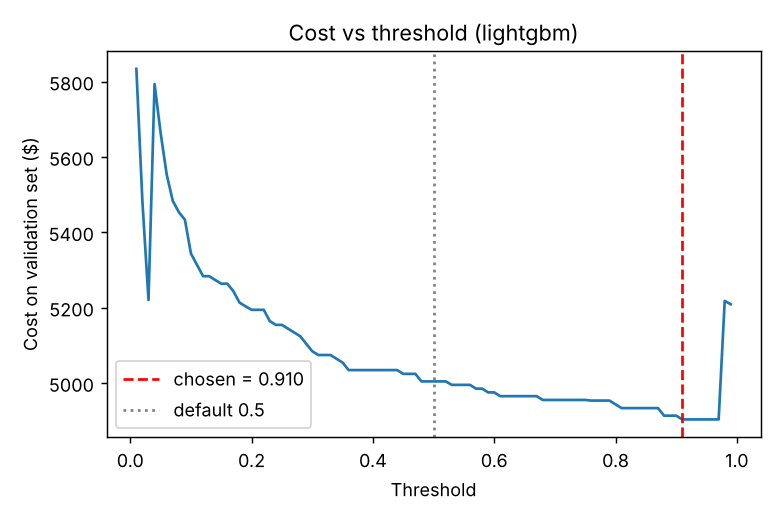
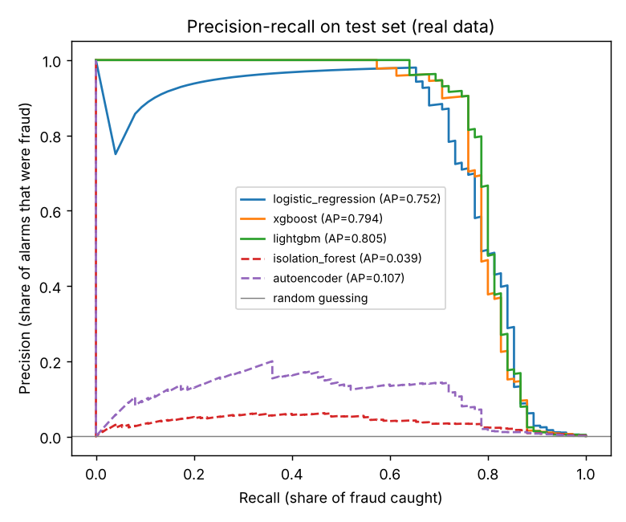
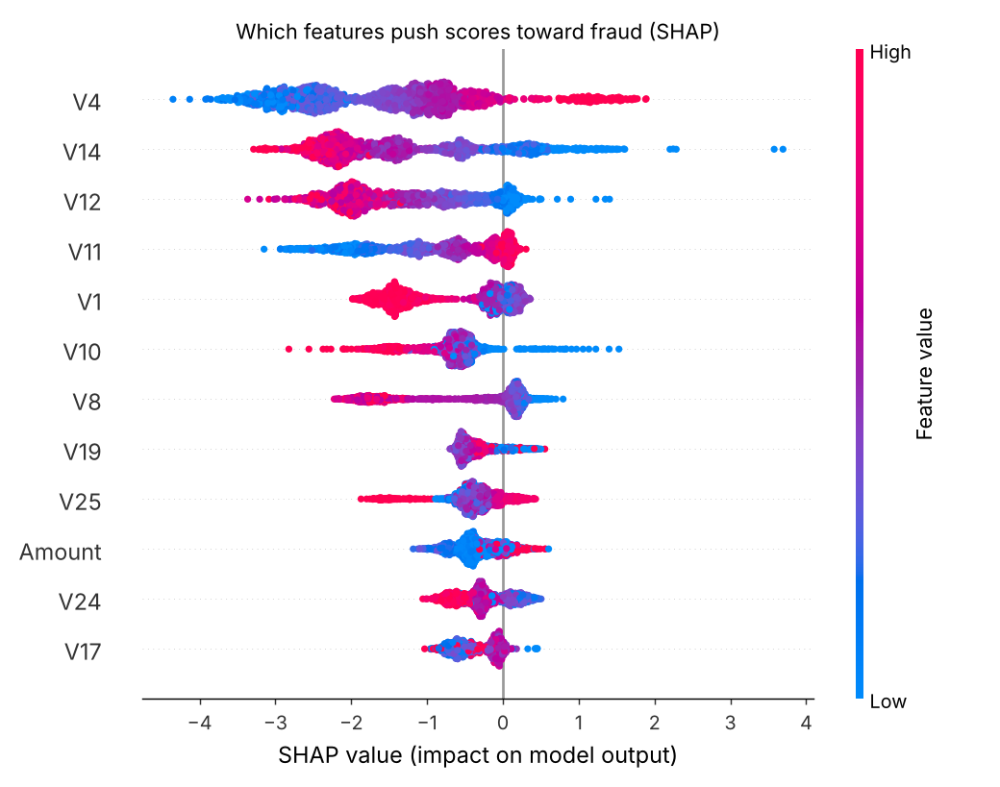

# Results (real data)

Rows: 284,807 | fraud rows: 492 | fraud rate: 0.1727%  
Time split (oldest→newest): train 170,884 (360 fraud), val 56,961 (57 fraud), test 56,962 (75 fraud)

## 1. The accuracy trap

A model that labels **every** transaction legit scores **99.8683% accuracy** on the test set and catches **0** fraud. Its PR-AUC is 0.0013 (= the fraud rate).

## 2. Supervised models (test set, threshold 0.5)

| model | PR-AUC (95% bootstrap CI) | ROC-AUC | precision | recall | accuracy | alarms |
|---|---|---|---|---|---|---|
| logistic_regression | 0.752 (0.640–0.862) | 0.9835 | 0.028 | 0.907 | 0.9588 | 2405 |
| xgboost | 0.794 (0.704–0.876) | 0.9784 | 0.722 | 0.760 | 0.9993 | 79 |
| lightgbm | 0.805 (0.722–0.885) | 0.9760 | 0.817 | 0.773 | 0.9995 | 71 |

Best on validation PR-AUC: **lightgbm**.

## 3. Choosing the threshold by cost

Assumptions: missed fraud costs its Amount; every alarm costs $10 to review.

| policy (test set) | cost | precision | recall | alarms |
|---|---|---|---|---|
| flag nothing | $7,729 | – | 0 | 0 |
| threshold 0.5 | $3,347 | 0.817 | 0.773 | 71 |
| threshold 0.910 (picked on val) | $4,255 | 0.903 | 0.747 | 62 |

**Sensitivity check:** cost at several thresholds, validation vs test.

| threshold | val cost | test cost |
|---|---|---|
| 0.1 | $5,343 | $3,643 |
| 0.3 | $5,084 | $3,405 |
| 0.5 | $5,004 | $3,347 |
| 0.7 | $4,955 | $3,298 |
| 0.9 | $4,913 | $3,268 |
| 0.91 | $4,903 | $4,255 |
| 0.95 | $4,903 | $4,255 |

Median fraud amount: $39.45 (val), $4.69 (test). Share of frauds smaller than the $10 review cost: 44% (val), 60% (test).

## 4. Unsupervised detectors (no fraud labels used in training)

Isolation Forest PR-AUC: 0.0391  
Autoencoder PR-AUC: 0.1072

## 5. SMOTE leakage demo (cross-validated PR-AUC, training period)

| how SMOTE was applied | PR-AUC (mean ± std) |
|---|---|
| WRONG: before the split | 1.0000 ± 0.0000 |
| RIGHT: inside each training fold | 0.8644 ± 0.0319 |

The 'wrong' number is also scored on a test fold that contains fake SMOTE fraud rows, so it is not measuring real-world performance at all.

## 6. Reason codes (top 10 highest-scored test transactions, XGBoost)

|   row |   fraud_score |   actually_fraud | reason_1           | reason_2          | reason_3          |
|------:|--------------:|-----------------:|:-------------------|:------------------|:------------------|
| 35479 |        1      |                1 | V14=-4.29 (+3.61)  | V12=-5.27 (+1.32) | V10=-4.53 (+1.11) |
| 13600 |        0.9999 |                1 | V14=-7.62 (+3.95)  | V12=-4.17 (+1.36) | V10=-4.76 (+1.23) |
| 15548 |        0.9999 |                1 | V14=-8.76 (+3.34)  | V12=-6.15 (+1.35) | V4=3.60 (+1.17)   |
| 53299 |        0.9999 |                1 | V14=-6.42 (+4.21)  | V10=-5.25 (+1.36) | V12=-5.03 (+1.26) |
| 52018 |        0.9999 |                1 | V14=-6.67 (+3.84)  | V10=-5.59 (+1.38) | V12=-5.42 (+1.28) |
| 15854 |        0.9999 |                1 | V14=-14.27 (+3.42) | V12=-9.32 (+1.30) | V4=6.50 (+1.27)   |
| 49019 |        0.9999 |                1 | V14=-4.70 (+2.89)  | V12=-3.91 (+1.42) | V10=-4.39 (+0.99) |
|  7771 |        0.9999 |                1 | V14=-3.94 (+3.61)  | V4=6.31 (+1.30)   | V12=-6.17 (+1.28) |
| 15904 |        0.9999 |                1 | V14=-13.97 (+3.19) | V12=-9.00 (+1.31) | V4=7.78 (+1.21)   |
| 35429 |        0.9998 |                1 | V14=-13.01 (+3.47) | V12=-7.61 (+1.26) | V4=7.76 (+1.24)   |

_Runtime: 72.9 s_
